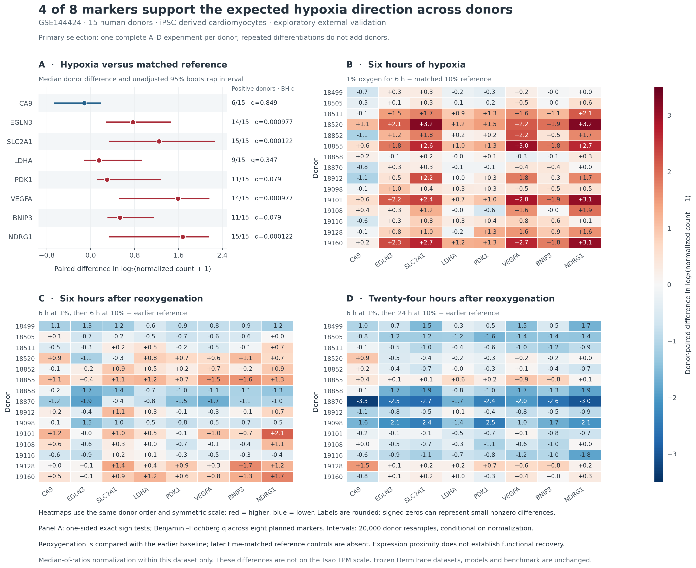

# GSE144424: exploratory donor validation of the AC16 oxygen-response panel

## Result

**The human AC16 marker pattern transfers partially to donor-derived cardiomyocyte cultures.** EGLN3, SLC2A1, VEGFA and NDRG1 increase in 14–15 of 15 donors and pass the fixed eight-marker directional test. Seven of eight markers have positive median changes, but that alone does not establish consistent induction across donors. CA9, one of the clear AC16 examples, increases in only six donors and has a slightly negative median; this is lack of support for the expected positive direction, not evidence of significant downregulation.

Added a separate curated package at `data/curated/gse144424_cardiomyocyte_v1/`: 19,081 genes × 84 native count profiles, representing 15 human donors and 21 differentiation experiments. No raw sequencing reads were downloaded. No model was trained or scored, no existing target or partition was reassigned, and no existing benchmark or app content was changed by this addition.



## Primary comparison

One published differentiation selection per donor gives 60 profiles (15 matched A–D quartets). Hypoxia B is six hours at 1% oxygen; A is the matched 10% reference, harvested at the same six-hour point. The primary outcome is B−A in log2(median-ratio normalized count + 1). It is not TPM and is not on the same effect-size scale as the Tsao plot.

| Marker | Donors increasing | Median paired Δ | 95% bootstrap interval | BH q |
|---|---:|---:|---:|---:|
| CA9 | 6/15 | -0.116 | [-0.659, +0.175] | 0.849121 |
| EGLN3 | 14/15 | +0.767 | [+0.297, +1.450] | 0.000977 |
| SLC2A1 | 15/15 | +1.246 | [+0.340, +2.250] | 0.000122 |
| LDHA | 9/15 | +0.151 | [-0.115, +0.916] | 0.346994 |
| PDK1 | 11/15 | +0.296 | [+0.129, +1.265] | 0.078979 |
| VEGFA | 14/15 | +1.590 | [+0.531, +2.154] | 0.000977 |
| BNIP3 | 11/15 | +0.532 | [+0.318, +1.136] | 0.078979 |
| NDRG1 | 15/15 | +1.677 | [+0.342, +2.144] | 0.000122 |

The expected positive direction and eight markers were fixed from the [AC16 reference snapshot](reference/README.md) before inspecting these donor effects. Exact one-sided sign tests ask whether positive changes occur in more than half of donors, with Benjamini–Hochberg adjustment across eight markers. The analysis plan calls directional support at q≤0.05 and positive median. Intervals are unadjusted percentile intervals from 20,000 donor bootstrap resamples, conditional on normalization; they address the median and are not interchangeable with the multiplicity-adjusted sign test. PDK1 and BNIP3 have positive median estimates but do not pass the primary directional criterion (q≈0.079). LDHA is inconsistent (9/15 increasing, q≈0.347).

## Robustness to repeats and normalization

Numbers below count independent donors, after averaging matched experiment-level changes within each donor where repeats are included. Repeated differentiations never add donors.

| Marker | Primary | Repeat-averaged, QC | Repeat-averaged, all | CPM sensitivity |
|---|---:|---:|---:|---:|
| CA9 | 6/15 | 5/15 | 5/15 | 6/15 |
| EGLN3 | 14/15 | 14/15 | 14/15 | 15/15 |
| SLC2A1 | 15/15 | 15/15 | 15/15 | 15/15 |
| LDHA | 9/15 | 8/15 | 9/15 | 10/15 |
| PDK1 | 11/15 | 11/15 | 11/15 | 11/15 |
| VEGFA | 14/15 | 14/15 | 14/15 | 14/15 |
| BNIP3 | 11/15 | 11/15 | 11/15 | 15/15 |
| NDRG1 | 15/15 | 15/15 | 15/15 | 15/15 |

The same four genes pass q≤0.05 in both repeat sensitivities and CPM normalization. CA9 retains a negative median in all four analyses. **BNIP3 is normalization-sensitive:** it increases in 11/15 donors with median-ratio normalization but 15/15 with CPM and crosses the significance threshold only under CPM. This sensitivity does not replace the prespecified primary result. All eight median directions are unchanged between normalization methods, while some donor signs differ.

CA9 is much less abundant than the other markers (primary A/B normalized-count medians 26.93/32.83; CPM medians 0.96/1.14), making its pseudocount-dependent magnitude particularly unsuitable for direct comparison with AC16 TPM. The count threshold used for abundance annotation is not applied to CPM values.

## Reoxygenation: expression declines, but does not uniformly return to baseline

Among the four consistently supported hypoxia markers, EGLN3, VEGFA and NDRG1 decline from B in all 15 donors after six hours of reoxygenation; SLC2A1 declines in 14/15. At 24 hours all four decline from B in all 15 donors.

Declining from hypoxia is different from being closer to the original reference. At six hours, 10/15 donors are closer to reference for SLC2A1, VEGFA and NDRG1, and 8/15 for EGLN3. At 24 hours these counts are 9/15 and 7/15 respectively. All four have negative median changes relative to A at 24 hours; several donors cross below the earlier reference. This supports time-dependent transcriptional change, not a claim that every donor returned to a normal state.

These secondary comparisons are descriptive, with no secondary significance claims. A/B were harvested at experiment hour 6, C at hour 12 and D at hour 30. Later time-matched continued-normoxia controls are absent, so elapsed culture time cannot be separated completely from oxygen-history effects. RNA measurements do not establish functional recovery or injury.

## How this can expand DermTrace

1. The package provides an inspectable human cardiomyocyte exposure dataset with donor, differentiation, oxygen and timing metadata. It can support a separately versioned future oxygen-response task, with every differentiation and timepoint from a donor kept in the same partition.
2. The four consistently supported genes are candidates for an oxygen-response feature panel; CA9 should not be treated as a universal positive control. Selecting those four using this dataset makes subsequent performance on the same donors development evidence, not a new blind test.
3. A future model must be compared with a simple baseline and evaluated on additional held-out donors/studies. This analysis establishes neither classifier accuracy nor improvement over the existing DermTrace model. GSE144424 has now been inspected and should not be relabeled an untouched test set.
4. Keep human and mouse analyses separate. These human data do not independently validate HL-1, a species difference, Tsao's sustained-1% arm, or its unknown-duration reoxygenation exposure. The studies also differ in reference oxygen (10% versus 20%) and cell model.

## Methods, provenance and boundaries

- `analysis_plan.json` is preserved verbatim from after metadata review and before inspecting GSE144424 marker effects. It is a documented analysis plan, not an external preregistration. Its existing-TEST/local-release wording refers to the original local analysis context, not a newly shipped benchmark or split; this addition includes and changes no such release or split.
- Primary selection follows the paper: experiment 2 for donors 18511, 18852 and 18855; experiment 1 for the other 12 donors. The full source matrix remains retained.
- Repeat sensitivity with QC uses 20 complete quartets/80 profiles, omitting the original 18852 quartet with the published A outlier and D with undetermined RIN. The all-profile sensitivity includes all 21 quartets/84 profiles. No baseline is substituted from a different differentiation.
- Normalization uses the actual autosomal annotations. The downloaded file contains 18,226 autosomal and 855 nonautosomal genes despite GEO's autosomal-only description. Native rows are preserved in the curated package. The primary median-ratio reference uses 12,820 autosomal genes positive across all 60 selected profiles; each sensitivity is normalized separately.
- Eight marker symbols map uniquely to source Ensembl IDs, verified using the hashed local Tsao gene annotation. Expression is never pooled across the studies.
- This is a new exploratory count-normalization/paired-marker analysis, not a reproduction of the paper's TMM/voom/limma/RUV differential model. No fitted batch factors, genome-wide DE or predictive training is performed. Culture purity and technical variation remain limitations.
- The compact [AC16 reference provenance](reference/provenance.json) pins the tracked TPM matrix, metadata and snapshot hashes. All 32 marker/arm means and contrasts were independently checked against those tracked inputs. This new GSE144424 package is separate from existing releases and does not change their inputs or partitions.

Source design: [Ward et al., eLife 2021](https://elifesciences.org/articles/57345). Native processed inputs, metadata, source URLs and checksums are recorded in the [curated package README](../../data/curated/gse144424_cardiomyocyte_v1/README.md), `provenance.json` and `manifest.json`.

## Reproduce and inspect

Use Python 3.10, matching CI. From the repository root, create an environment and install the repository's pinned analysis dependencies:

```sh
python3.10 -m venv .venv
. .venv/bin/activate
python -m pip install -r keloidbench/requirements-revision.txt
```

Then run the ingestion, analysis, figure generation and checks:

```sh
python scripts/ingest_gse144424.py
python scripts/analyze_gse144424.py
python analysis/gse144424_oxygen_validation_2026-10-27/plot_validation.py
python -m unittest discover -s tests -p 'test_gse144424*.py' -v
```

- `primary_donor_expression.csv`: every primary sample/marker abundance and metadata.
- `experiment_deltas.csv`: matched differences before donor aggregation.
- `donor_deltas.csv`: independent donor-level differences for every analysis/contrast.
- `marker_summary.csv`: all estimates, donor counts, primary sign tests and sensitivity results.
- `reoxygenation_summary.csv`: closer-to-reference and overshoot counts.
- `ac16_direction_comparison.csv`: direction comparison, with the different scales explicitly named.
- `normalization_factors.csv`: every size factor.
- `analysis_manifest.json`: exact analysis inputs, code/plan hashes and CSV hashes.
- `donor_oxygen_response.png` and `.pdf`: figure generated from saved results.
- `verification.json`: test/integrity checks and protected-file comparison.
